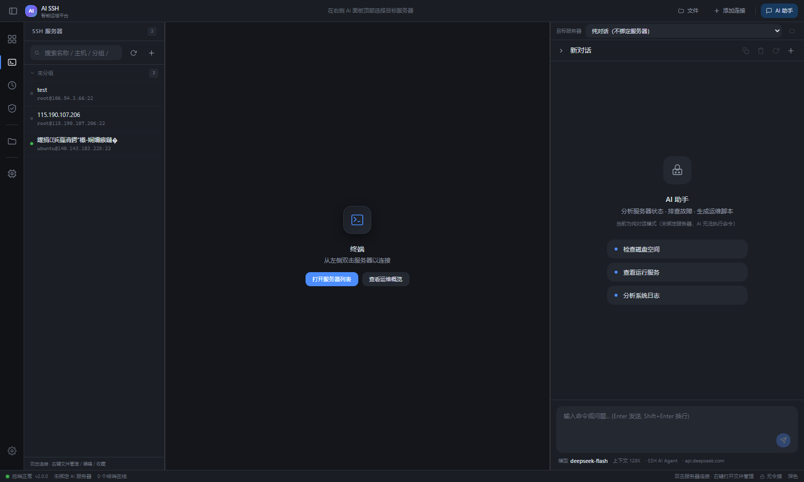
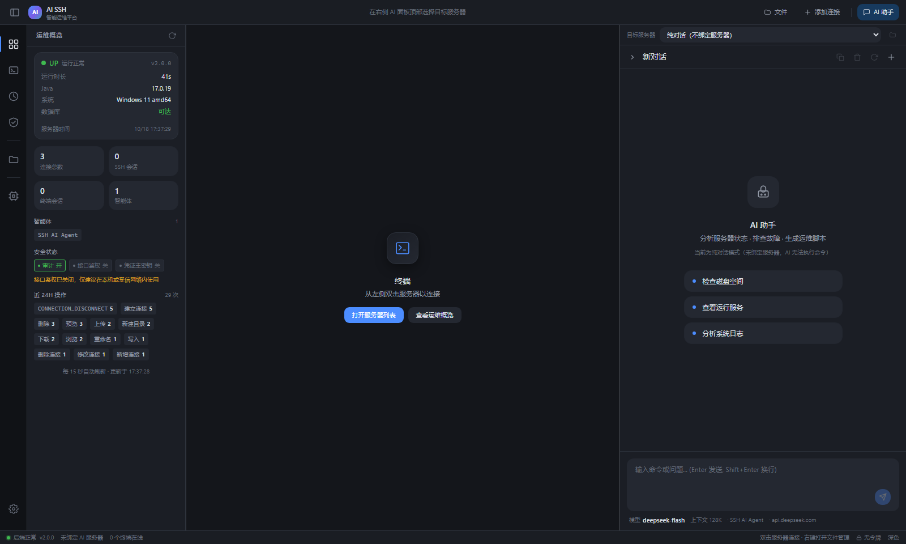
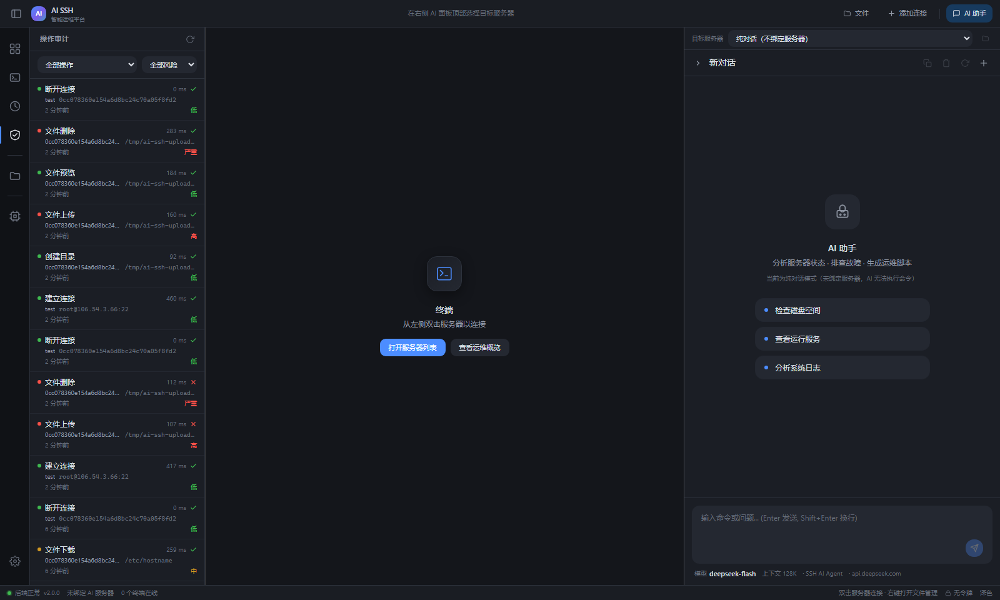
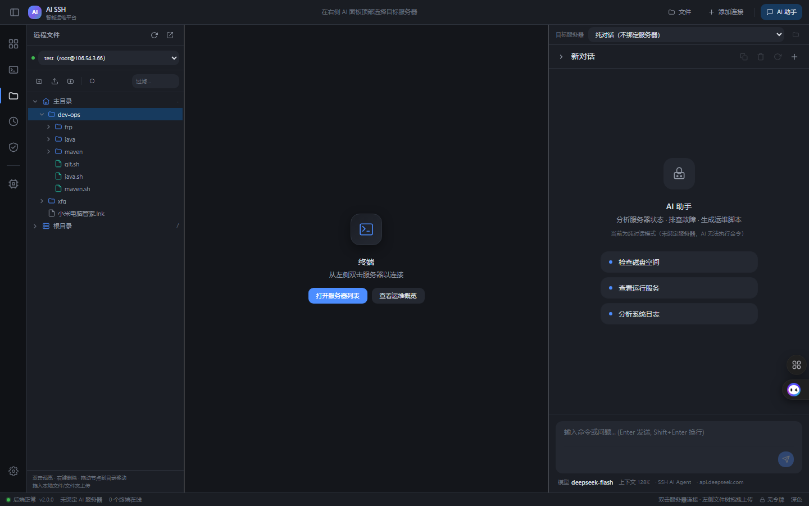
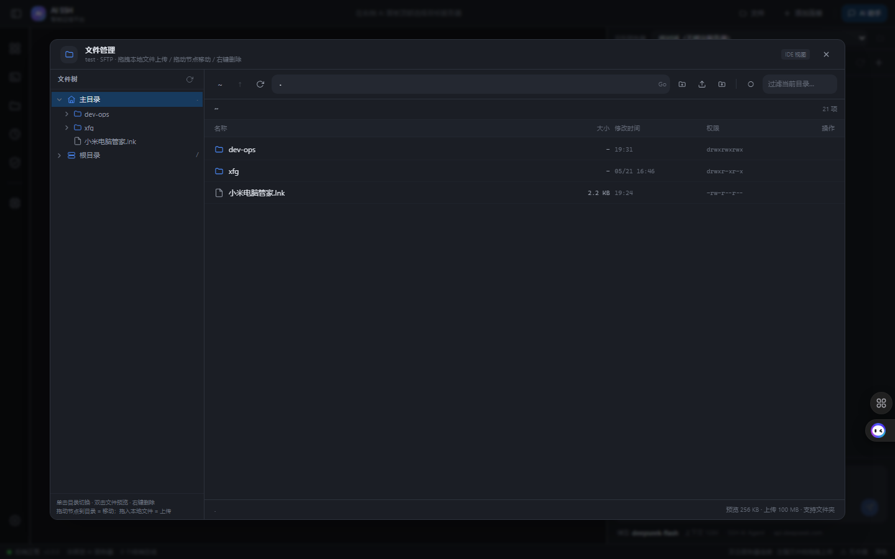
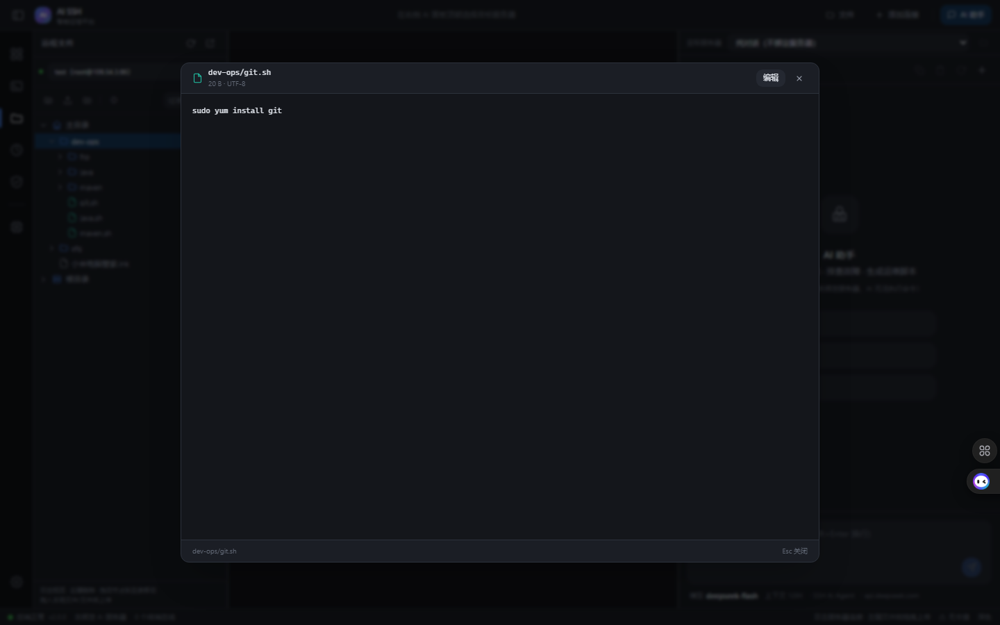
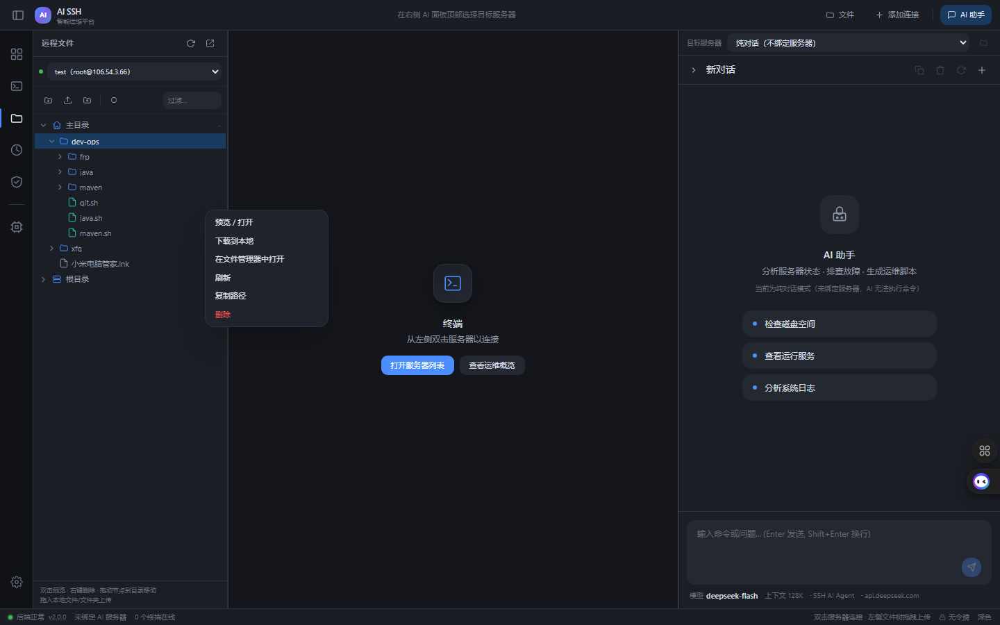
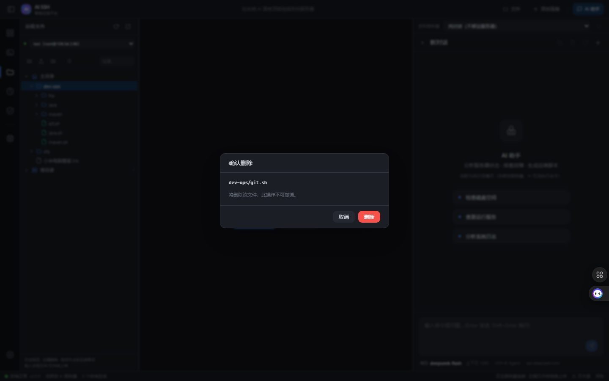
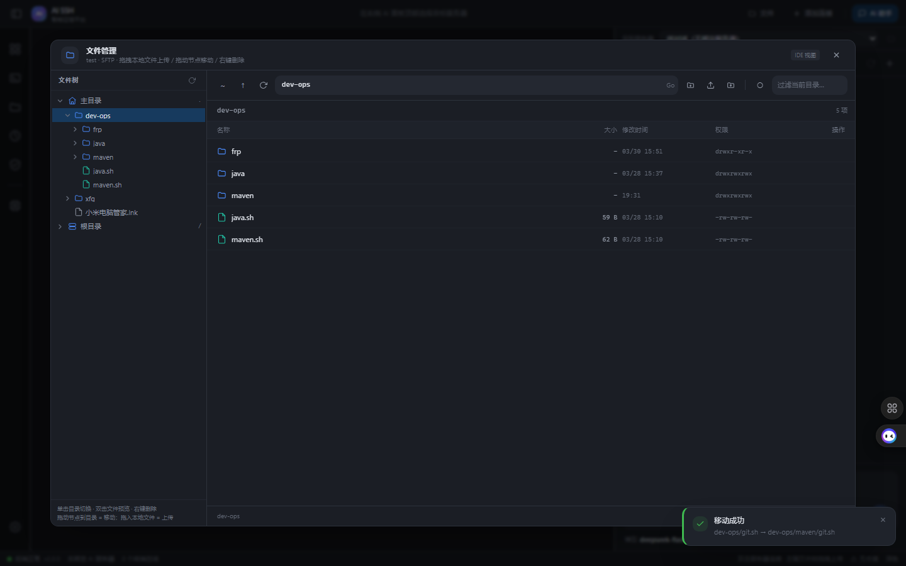
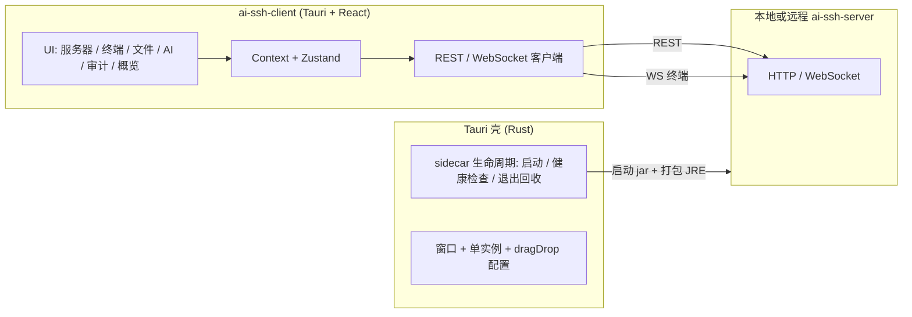

# AI SSH 桌面客户端

AI 驱动的 SSH 运维桌面客户端：把 **连接管理、终端、远程文件、操作审计与 AI 运维助手** 组合在一个 Tauri 窗口里。

- 客户端：Tauri v2 + React 19 + TypeScript + Tailwind CSS v4 + Zustand + xterm.js
- 桌面一体化：安装包内置服务端 jar 与精简 JRE，启动时由 Rust 拉起本地 sidecar，开箱即用，无需预装 Java / MySQL
- 服务端仓库：[fengbaohuo1/ai-ssh-server](https://github.com/fengbaohuo1/ai-ssh-server)

## 功能特性

**SSH 与终端**

- 主机管理：分组、标签、备注、收藏、最近成功连接时间，密码 / 私钥两种认证，私钥支持粘贴 PEM。
- 多标签终端：基于 xterm.js 的 WebSocket 终端，按服务器分标签页，支持多窗口布局（allotment 可拖拽分栏）。
- 远程文件：左侧常驻 IDE 风格文件树 + 右侧文件管理器（左树右列表、面包屑、路径直达、过滤、隐藏文件），支持预览 / 编辑 / 上传 / 下载 / 新建目录 / 重命名 / 拖动移动 / 右键删除；拖拽上传文件与整个文件夹，带进度。

**AI 运维助手**

- SSE 流式对话，步骤可视化：思考草稿、`tool_call` / `tool_result`（含耗时与成败）、用量统计、子智能体嵌套步骤。
- 子智能体协作：父智能体按 `delegate-mode` 直连执行或派发子智能体，支持指名派发、批量并行派发、规划后派发；派发预算与执行痕迹由服务端治理，前端展示每个子任务的命令与结论。
- 当前服务器绑定自愈：选中服务器会持久化，刷新 / 重启后自动恢复并重连；未绑定时发送会提示先连接服务器，服务端也会明确告知"未绑定"而不是空转。

**平台能力**

- 运维概览、操作审计（按动作 / 风险 / 连接筛选）、全局命令面板（`Ctrl/⌘ + K`）、底部状态栏。
- 设置页：外观（深浅主题）、安全（接口令牌）、快捷键、模型配置、Agent 配置。
- 模型与 Agent 配置保存后**立即热重装**，无需重启后端；API Key 只写不回显。

## 界面截图

| 主界面 | 运维概览 | 操作审计 |
|---|---|---|
|  |  |  |

| 远程文件树（左侧常驻） | IDE 文件管理器 | 文本预览 / 编辑 |
|---|---|---|
|  |  |  |

| 右键删除 | 删除确认 | 列表拖动移动 |
|---|---|---|
|  |  |  |

## 架构



- 桌面端启动时 Rust 侧在随机空闲端口拉起打包的后端（`--spring.profiles.active=local`），健康检查通过后把真实 `baseUrl` 注入前端；退出时回收子进程。
- 前端所有请求经 `src/api/client.ts` 单一出口发往注入的 `baseUrl`，不在业务代码里硬编码端口。

## 快速开始（开发调试）

### 环境要求

| 依赖 | 说明 |
|---|---|
| Node.js | ≥ 20.19（Vite 7 要求；本项目已在 Node 24 验证） |
| Rust | stable 工具链 + MSVC Build Tools（Tauri v2） |
| WebView2 | Windows 10/11 自带 / 可独立安装 |
| JDK 17 + Maven | 仅开发后端与打包 sidecar 时需要（后端仓库） |

### 方式一：IDEA 起后端 + Tauri 桌面端（推荐，前后端分离调试）

```bash
# 1) 在 ai-ssh-server 仓库用 IDEA 运行 Application（或命令行 mvn -pl ai-ssh-server-app -am spring-boot:run）
#    后端监听 http://localhost:8091，默认 local profile（H2 文件库，零依赖）

# 2) 桌面端
cd ai-ssh-client
npm install
npm run tauri dev
```

桌面端会**复用**已在 8091 起的后端（复用前做健康检查，不健康才另行拉起 sidecar）；设置 `AI_SSH_DEV_LOCAL=1` 可强制使用打包的 sidecar。

### 方式二：纯浏览器调试

```bash
cd ai-ssh-client
npm run dev    # Vite http://localhost:1420，/api 代理到 http://localhost:8091
```

> 首选端口 1420 被占用时 Vite 会自动 +1 找空闲端口，并把实际端口写入 `src-tauri/.dev-port.json`，`tauri dev` 的窗口会跟随实际端口，不会白屏。

## 构建安装包

```bash
cd ai-ssh-client

# 打包后端 jar + jlink 精简 JRE（需要 JDK 17 + Maven；产物在 src-tauri/resources/，不入版本库）
npm run backend:bundle

# 生成 Windows 安装包（NSIS + MSI）
npm run desktop:build
```

- 安装包产物在 `src-tauri/target/release/bundle/`。
- 只想复用已有 JRE：`npm run backend:bundle -- -SkipJre`。
- `scripts/bundle-backend.ps1` **必须保持 ASCII-only**：Windows PowerShell 5.1 会以 ANSI/GBK 读取无 BOM 的 UTF-8 脚本，中文会导致解析失败。
- `npm run build` 只做前端 `tsc && vite build`，不产出安装包。

## 目录结构

```
ai-ssh-client/
├── src/
│   ├── api/            # 后端契约封装（client / ssh / files / audit / system / chat / agentConfig）
│   ├── components/     # server / terminal / files / chat / audit / overview / settings / history / layout / ui
│   ├── contexts/       # SshContext / TerminalContext / ChatContext
│   ├── hooks/          # 复用逻辑
│   ├── stores/         # Zustand：layout / theme / toast / security / fileExplorer
│   ├── types/          # 领域类型
│   └── BackendGate.tsx # 桌面端启动闸门（等待 sidecar 健康后注入 baseUrl）
├── src-tauri/
│   ├── src/backend.rs  # sidecar 生命周期：启动 / 健康检查 / 端口注入 / 退出回收
│   ├── src/lib.rs      # Tauri 命令注册、开发端口联动
│   └── resources/      # 打包产物：backend/ai-ssh-server-app.jar、jre/
├── scripts/bundle-backend.ps1  # Maven 打包 + jlink（ASCII-only）
├── docs/screenshots/   # README 用截图
├── package.json
└── vite.config.ts      # dev 端口联动 + /api 代理到 8091
```

## 配置与数据

- 桌面端数据目录：`%APPDATA%\jianingfei.site.aissh`（`data/` H2 库、`config/` `agent.yml` + `llm.yml`、`logs/`），可通过 `AI_SSH_HOME` 覆盖。
- 模型 / Agent 配置在应用内「设置」页维护，保存后后端热重装生效，**不需要重启**；配置写坏时后端拒绝落盘并提示原因。
- 桌面端拖拽上传依赖 WebView 的 HTML5 拖放事件，`src-tauri/tauri.conf.json` 已设置 `"dragDropEnabled": false`；新增窗口需保持该配置，否则 Tauri 会拦截系统文件拖入事件。

## 环境变量

| 变量 | 说明 |
|---|---|
| `AI_SSH_HOME` | 后端数据目录（桌面端由 Rust 注入 `%APPDATA%\jianingfei.site.aissh`） |
| `AI_SSH_DB_URL` / `AI_SSH_DB_USERNAME` / `AI_SSH_DB_PASSWORD` | 连 MySQL 部署的后端时需要 |
| `AI_SSH_LLM_API_KEY` | 首次无 API Key 时可用环境变量注入（也可在设置页填写） |
| `AI_SSH_DEV_LOCAL` | `tauri dev` 下强制使用打包的 sidecar 后端 |

## 技术栈

| 层 | 选型 |
|---|---|
| 桌面壳 | Tauri v2（Rust） |
| UI | React 19 + TypeScript + Tailwind CSS v4 |
| 状态 | React Context + Zustand |
| 终端 | xterm.js（`@xterm/xterm` + fit / web-links 插件） |
| 布局 | allotment 可拖拽分栏 |
| 构建 | Vite 7 |

## 相关仓库

- 服务端：[fengbaohuo1/ai-ssh-server](https://github.com/fengbaohuo1/ai-ssh-server)
- 开发约定见仓库内 `AGENTS.md`（目录规范、桌面 sidecar 约定、构建注意事项）。
